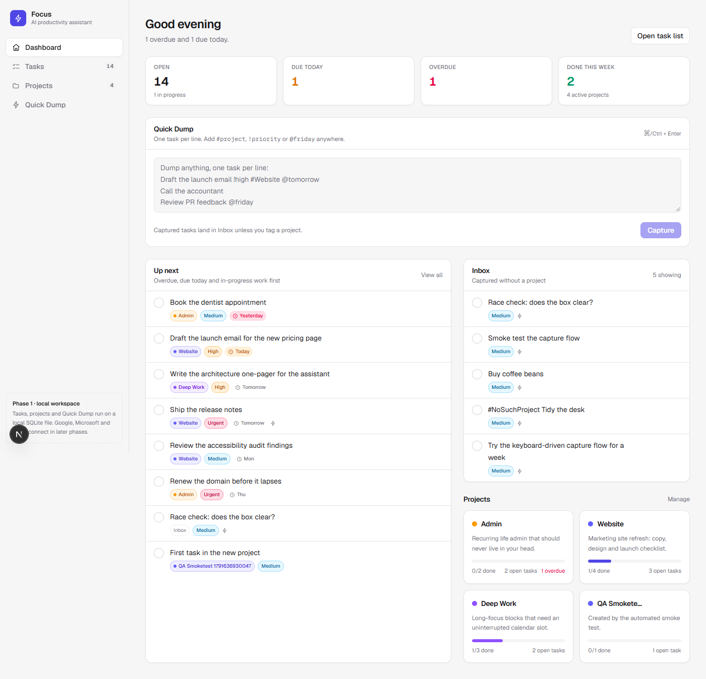
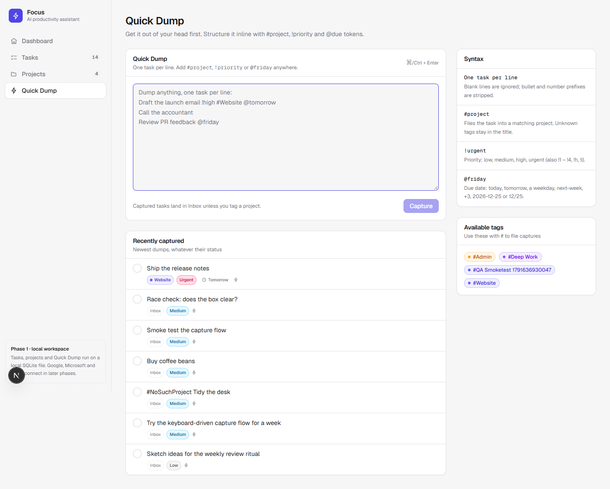
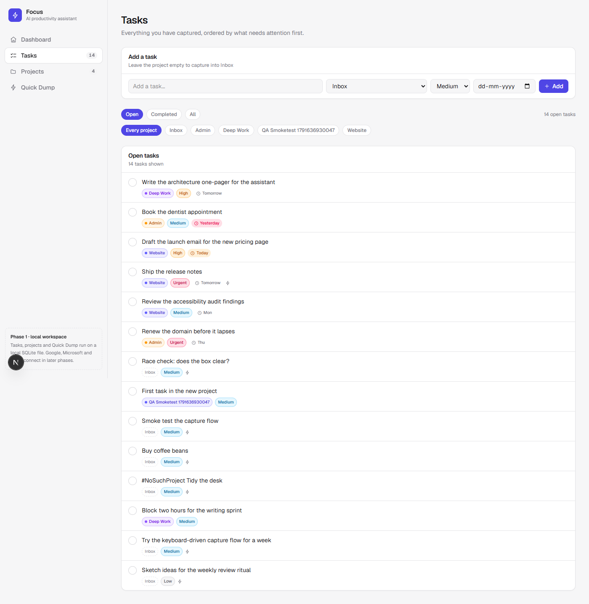
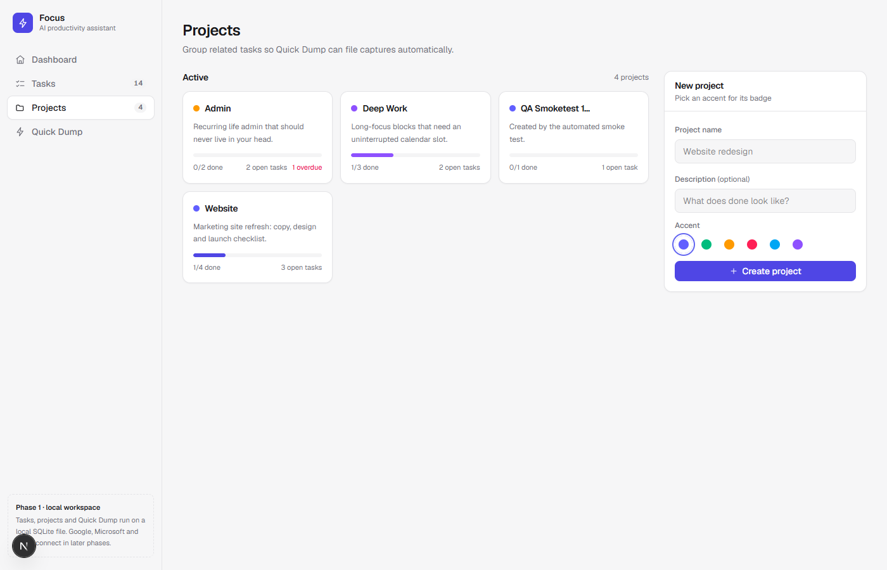
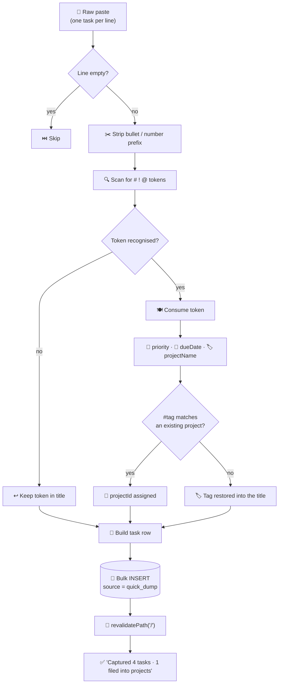
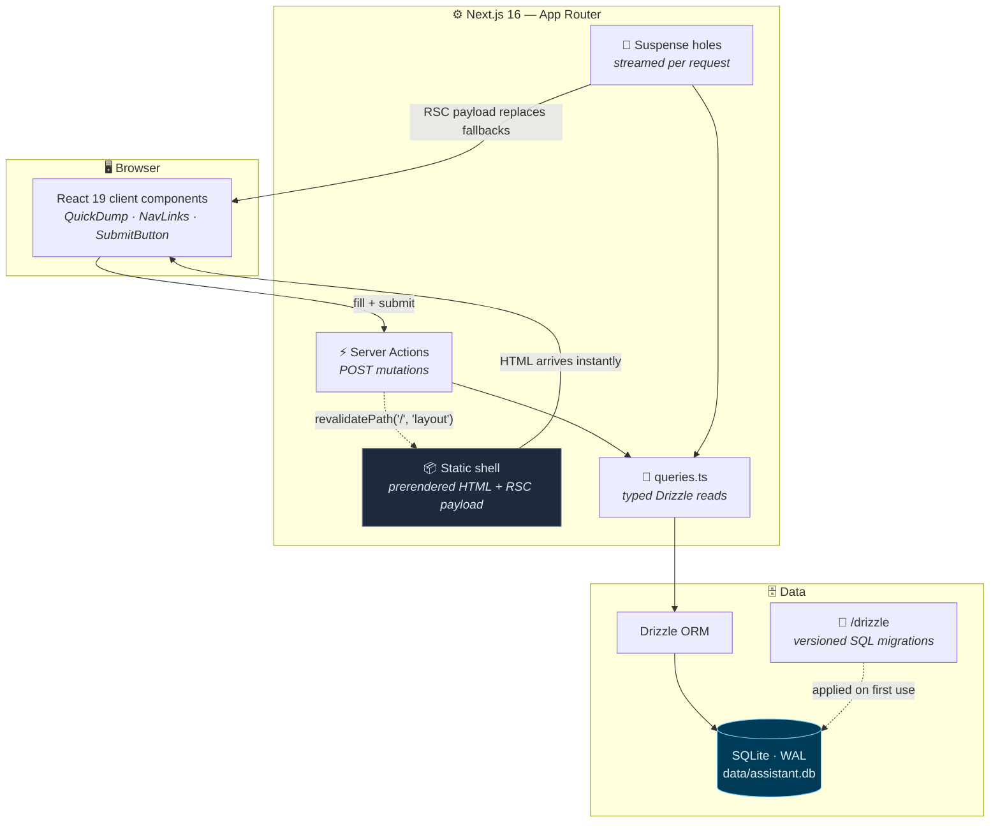
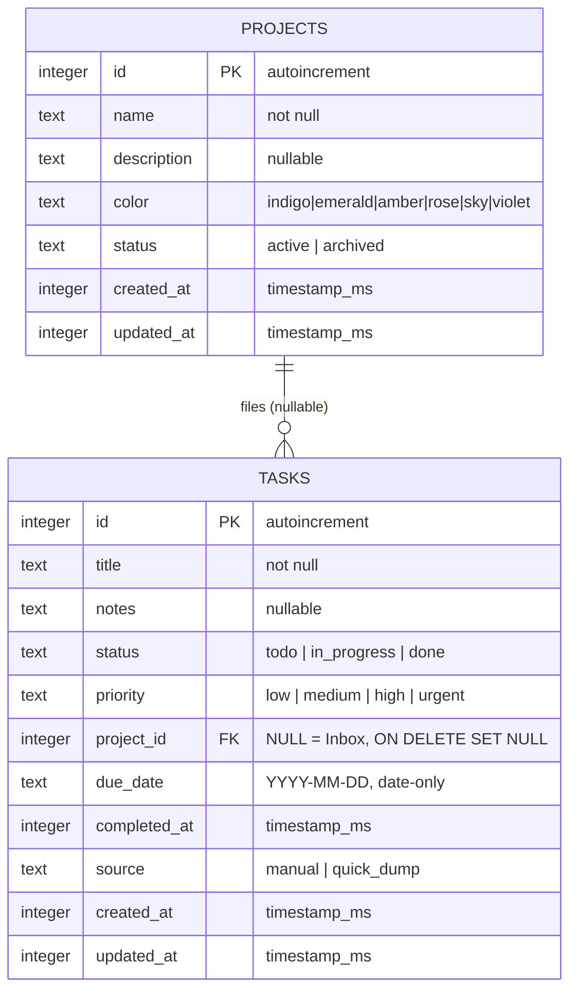
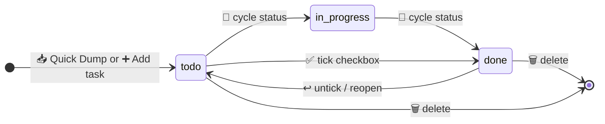
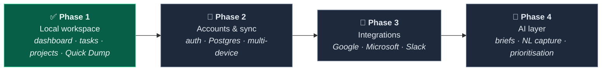

<div align="center">

# ⚡ Focus

### Personal AI Productivity Assistant

**A local-first command centre for tasks, projects and fast capture.**
Build a working product first — connect Google, Microsoft and Slack one at a time afterwards.

[](https://nextjs.org)
[](https://react.dev)
[](https://www.typescriptlang.org)
[](https://tailwindcss.com)
[](https://github.com/WiseLibs/better-sqlite3)
[](https://orm.drizzle.team)
[](#-testing)
[](#-roadmap)

<br />



<sub>The dashboard — Quick Dump, a triage queue ordered by what is actually late, and live project progress.</sub>

</div>

---

## 📖 Table of contents

| | Section | | Section |
|---|---|---|---|
| ⚡ | [What is Focus?](#-what-is-focus) | 🗂️ | [Project structure](#-project-structure) |
| 🖼️ | [Screenshots](#-screenshots) | 🚀 | [Getting started](#-getting-started) |
| ✨ | [Features](#-features) | 🧪 | [Testing](#-testing) |
| 🧠 | [Quick Dump syntax](#-quick-dump-syntax) | 🧭 | [Design decisions](#-design-decisions) |
| 🏗️ | [Architecture](#-architecture) | 🗺️ | [Roadmap](#-roadmap) |
| 🔄 | [Request lifecycle](#-request-lifecycle) | ⚠️ | [Known limitations](#-known-limitations) |
| 🗄️ | [Data model](#-data-model) | 📄 | [License](#-license) |
| 🧰 | [Tech stack](#-tech-stack) | | |

---

## ⚡ What is Focus?

Focus is a **single-user, local-first productivity workspace**. Everything runs on your machine against a SQLite file — no account, no cloud, no API keys. It exists to answer one question well: *what should I do next?*

It was built in deliberate phases. **Phase 1 (this repo) is the working product**: a real dashboard, real tasks, real projects and a capture flow fast enough that you actually use it. Integrations and AI come after the core is proven — a beautiful interface with integrations that do not work is worth less than a plain one that does.

```
Capture first, organise later.
```

---

## 🖼️ Screenshots

<table>
  <tr>
    <td width="50%" align="center">
      <br />
      <sub><b>Quick Dump</b> — live parse preview before anything is saved</sub>
    </td>
    <td width="50%" align="center">
      <br />
      <sub><b>Tasks</b> — status + project filters, inline status cycling</sub>
    </td>
  </tr>
  <tr>
    <td colspan="2" align="center">
      <br />
      <sub><b>Projects</b> — grouped work with progress, archive and accent colours</sub>
    </td>
  </tr>
</table>

---

## ✨ Features

### 🧠 Quick Dump — capture without friction

| | Capability |
|---|---|
| ⚡ | **One task per line.** Paste a whole brain-dump; blank lines are skipped and bullet/number prefixes are stripped. |
| 👀 | **Live preview.** Every line is parsed as you type, before you commit anything — you see the tasks you are about to create. |
| 🏷️ | **Inline structure.** `#project`, `!priority` and `@due` tokens can appear anywhere on a line. |
| 🛡️ | **Nothing is lost.** An unrecognised `@token` stays in the title, and a `#tag` with no matching project is kept in the title instead of being silently dropped. |
| ⌨️ | **Keyboard-first.** `⌘/Ctrl + Enter` captures and clears the box. |

### ✅ Tasks

- **Triage ordering that matches how you actually work:** overdue → due today → in progress → everything else, then soonest due date, then priority, then newest.
- **Ticked-done checkbox** plus a **status cycle** (`To do → In progress → Done → To do`) so a task can be parked without being finished.
- **Priority** (`low · medium · high · urgent`) with colour-coded badges.
- **Due dates** stored as date-only values so they never shift across timezones, rendered as `Overdue · Today · Tomorrow · Fri · Nov 2`.
- **Provenance badge** — a ⚡ marker shows which tasks arrived via Quick Dump.
- **Filters** by scope (open / completed / all) and by project or Inbox.

### 🗂️ Projects

- Progress bars with done/total, open and overdue counts.
- Six accent colours; each project gets a reusable `#tag`.
- **Archive / restore** instead of deleting history.
- Deleting a project **keeps its tasks** — the foreign key is `ON DELETE SET NULL`, so nothing you captured is ever lost.

### 🖥️ Dashboard

- Live stats: open, due today, overdue, done this week.
- Time-aware greeting that summarises the day in one line.
- Quick Dump front and centre, then **Up next**, **Inbox** and **active projects**.

---

## 🧠 Quick Dump syntax

```
Draft the launch email !high #Website @tomorrow
Call the accountant @friday
- Buy coffee beans
Review PR feedback #Deep Work !urgent @2026-12-25
```

| Token | Meaning | Accepted forms |
|---|---|---|
| `#project` | File into a project | Any project name; case-insensitive, matches spaces (`#Deep Work`) |
| `!priority` | Set priority | `!low` `!medium` `!high` `!urgent` · `!1`–`!4` · `!l` `!m` `!h` `!u` |
| `@due` | Set due date | `@today` `@tomorrow` `@yesterday` `@friday` `@mon` `@next-week` `@next-month` `@+3` `@2026-12-25` `@12/25` |

**Parsing pipeline** — note how unrecognised input is preserved rather than discarded:



---

## 🏗️ Architecture



**Three layers, one direction of dependency:**

| Layer | Location | Responsibility |
|---|---|---|
| 🎨 **UI** | `src/app`, `src/components` | Rendering, forms, pending/optimistic states. Knows nothing about SQL. |
| 🧠 **Domain** | `src/lib` | Parsing, date rules, validation, server actions. Pure and unit-testable. |
| 💾 **Data** | `src/db`, `drizzle/` | Schema, connection, migrations. The only place that touches SQLite. |

---

## 🔄 Request lifecycle

Focus runs with **Cache Components + Partial Prerendering** enabled (the Next.js 16 default). Every route ships a real HTML shell instantly, then streams its database-backed content in the same response.

```mermaid
sequenceDiagram
    autonumber
    participant B as 🖥️ Browser
    participant N as ⚙️ Next.js
    participant S as 🗄️ SQLite

    B->>N: GET /tasks?scope=open
    N-->>B: ⚡ Static shell (header, filter chips, nav, skeletons)
    Note over B: Page is painted — no blank screen

    rect rgb(30, 41, 59)
        Note over N,S: Streamed in the same response
        N->>N: await connection() — opt out of prerendering
        N->>S: SELECT tasks JOIN projects
        S-->>N: rows
    end

    N-->>B: 🌊 RSC payload replaces the fallbacks
    Note over B: Content swaps in

    B->>N: POST Server Action (e.g. Capture)
    N->>S: INSERT / UPDATE
    N->>N: revalidatePath('/', 'layout')
    N-->>B: 🔄 Fresh UI + new data in one roundtrip
```



| Step | Mechanism | Why it matters |
|---|---|---|
| 📦 Static shell | Prerendered at build time | Direct visits and prefetches are instant. |
| 🌊 Dynamic holes | `await connection()` inside `<Suspense>` | Local SQLite reads stay per-request and never bake stale data into the build. |
| ⚡ Mutations | Server Actions + `revalidatePath` | One roundtrip returns both the new data and the updated UI. |
| ➡️ Pending states | `useFormStatus` / `useActionState` | Buttons disable and labels change without hand-rolled state machines. |

---

## 🗄️ Data model



### Task lifecycle



**Indexes:** `tasks(status)`, `tasks(project_id)`, `tasks(due_date)` — the three columns every list query filters or sorts by.

---

## 🧰 Tech stack

| Layer | Choice | Notes |
|---|---|---|
| ⚛️ Framework | **Next.js 16.4** (App Router) | Cache Components + Partial Prerendering, Turbopack |
| 🧩 UI | **React 19.3** | Server Components by default; client only where interactivity is needed |
| 🔷 Language | **TypeScript 5** (`strict`) | Full inference from the Drizzle schema to the components |
| 🎨 Styling | **Tailwind CSS 4** | CSS-first `@theme` tokens, automatic light/dark via `prefers-color-scheme` |
| 🗄️ Database | **SQLite** via **better-sqlite3 13** | Zero-install, single file, WAL mode |
| 🔎 ORM | **Drizzle ORM 0.45** + **Drizzle Kit** | Typed queries, versioned SQL migrations |
| ✅ Tests | **`node:test`** + **tsx** | No test framework dependency |
| 🅰️ Fonts | **Geist Sans / Geist Mono** | via `next/font` (no layout shift) |

---

## 🗂️ Project structure

```text
Personal-Ai-Productivity-Assistant/
│
├── 📄 README.md                     ← you are here
├── 📄 AGENTS.md                     ← Next.js agent guidance (managed)
├── 📄 drizzle.config.ts             ← Drizzle Kit: schema + output paths
├── 📄 next.config.ts                ← Cache Components, PPR, external packages
├── 📄 tsconfig.json                 ← strict TS, `@/*` path alias
├── 📄 package.json
│
├── 📁 docs/                         ← README assets (screenshots)
│
├── 📁 drizzle/                      ← generated SQL migrations (committed)
│   ├── 0000_*.sql
│   └── meta/
│
├── 📁 scripts/
│   └── 📄 seed.ts                   ← idempotent demo data
│
├── 📁 data/                         ← 🚫 gitignored
│   └── 💾 assistant.db              ← your actual SQLite database
│
└── 📁 src/
    ├── 📁 app/                      ← routes (all Partial Prerender)
    │   ├── 📄 layout.tsx            ← app shell: sidebar + main region
    │   ├── 📄 globals.css           ← design tokens, theme, utilities
    │   ├── 📄 page.tsx              ← / dashboard
    │   ├── 📁 tasks/page.tsx        ← /tasks  filters + list
    │   ├── 📁 projects/
    │   │   ├── 📄 page.tsx          ← /projects  grid + create form
    │   │   └── 📁 [id]/page.tsx     ← /projects/:id  scoped detail
    │   └── 📁 dump/page.tsx         ← /dump  focused capture
    │
    ├── 📁 components/               ← presentational + interactive pieces
    │   ├── 📄 ui.tsx                ← Card, Pill, ProgressBar, EmptyState, Skeleton
    │   ├── 📄 icons.tsx             ← inline SVG icon set (no icon dependency)
    │   ├── 📄 sidebar.tsx           ← server: brand + streaming nav
    │   ├── 📄 nav-links.tsx         ← client: active route + hook-free fallback
    │   ├── 📄 quick-dump.tsx        ← client: capture box + live preview
    │   ├── 📄 task-item.tsx         ← toggle · status cycle · delete
    │   ├── 📄 task-list.tsx
    │   ├── 📄 new-task-form.tsx
    │   ├── 📄 project-form.tsx
    │   ├── 📄 project-card.tsx
    │   └── 📄 submit-button.tsx     ← useFormStatus pending + confirm()
    │
    ├── 📁 db/
    │   ├── 📄 schema.ts             ← tables, enums, indexes, inferred types
    │   └── 📄 index.ts              ← connection singleton + auto-migration
    │
    └── 📁 lib/
        ├── 📄 queries.ts            ← typed reads (tasks, projects, stats)
        ├── 📄 actions.ts            ← "use server" mutations
        ├── 📄 parse.ts              ← Quick Dump parser            🧪 tested
        ├── 📄 parse.test.ts         ← 15 tests
        ├── 📄 dates.ts              ← date-only helpers            🧪 tested
        ├── 📄 project-colors.ts     ← accents, priority + status styles
        └── 📄 utils.ts              ← cn, pluralize, buildHref
```

---

## 🚀 Getting started

### Prerequisites

- **Node.js 20.9+** (developed and verified on **Node 24**)
- npm 10+

### 1 · Install

```bash
git clone https://github.com/saikirantechy/Personal-Ai-Productivity-Assistant.git
cd Personal-Ai-Productivity-Assistant
npm install
```

### 2 · Seed demo data *(optional)*

```bash
npm run db:seed
```

Creates 3 projects and 10 tasks so the dashboard has something to show. It is **idempotent** — it skips if tasks already exist. The schema itself is migrated automatically the first time the app touches the database, so there is no separate migrate step to forget.

### 3 · Run

```bash
npm run dev
```

Open **http://localhost:3000** 🎉

Your data lives in `data/assistant.db`. Delete that file to start over.

### 4 · Production build

```bash
npm run build && npm start
```

---

## 📜 Scripts

| Command | Does |
|---|---|
| `npm run dev` | Start the dev server with Turbopack |
| `npm run build` | Production build (type-checks + prerenders) |
| `npm start` | Serve the production build |
| `npm test` | Run the unit tests (`node:test`) |
| `npm run typecheck` | `tsc --noEmit` |
| `npm run lint` | ESLint |
| `npm run db:seed` | Insert demo data if the database is empty |
| `npm run db:generate` | Generate a SQL migration from `schema.ts` |
| `npm run db:migrate` | Apply pending migrations (also runs automatically) |
| `npm run db:studio` | Browse the data in Drizzle Studio |

---

## 🧪 Testing

```bash
npm test
```

```text
▶ parseDump
  ✔ creates one task per non-empty line and skips blanks
  ✔ applies defaults when a line has no tokens
  ✔ strips bullet prefixes from pasted lists
  ✔ extracts priority, project, and due date tokens
  ✔ resolves relative and weekday due dates
  ✔ parses absolute dates and rejects invalid ones
  ✔ keeps unrecognised tokens in the title instead of dropping them
  ✔ accepts priority aliases and numbers
  ✔ keeps every token when a line is only tokens
  ✔ keeps extra project tags in the title
▶ matchProjectName
  ✔ matches case-insensitively
  ✔ returns null for unknown or missing names
▶ date helpers
  ✔ formats dates relative to today
  ✔ uses the local calendar day, not UTC
  ✔ returns null for unparseable tokens
ℹ tests 15   ℹ pass 15   ℹ fail 0
```

The parser is tested against a **fixed anchor date** (`Mon 2026-10-12`) so weekday and relative-date assertions are never flaky. Edge cases that are asserted rather than assumed:

- 🗓️ `@mon` on a Monday rolls forward a week instead of resolving to "today".
- 🚫 `2026-02-31` is rejected rather than silently rolling over to March.
- 🌍 A 23:30 local timestamp keeps its **local** calendar day.
- 🔤 `@sarah` and `!whatever` are preserved in the title, not swallowed.

**Also verified end-to-end in a real browser** (headless Chrome): capture → dashboard counters update → toggle complete → filter by Inbox → filter by Completed → create project → add a project-scoped task → unknown project renders 404. **0 console errors, 0 failed requests.**

---

## 🧭 Design decisions

<details open>
<summary><b>🧱 Phase 1 is deliberately integration-free</b></summary>

<br />

The fastest path to a product you actually use is a core that works offline. Adding OAuth before tasks are solid produces a demo that breaks the moment a token expires. Google, Microsoft and Slack are layered on top of a stable domain model — not woven through it.

</details>

<details>
<summary><b>🌊 Cache Components + <code>await connection()</code> instead of disabling caching</b></summary>

<br />

Next.js 16 marks synchronous embedded-database reads (`better-sqlite3`, `node:sqlite`) as *predictable* — which means a naive `db.select()` would be **baked into the build** and serve stale data forever.

Rather than opting the whole app out of prerendering, each route keeps a real static shell and puts its reads in `<Suspense>` behind `await connection()`. You get an instant first paint *and* per-request data.

</details>

<details>
<summary><b>📅 Due dates are <code>YYYY-MM-DD</code> strings, not timestamps</b></summary>

<br />

A due date is a *calendar day*, not an instant. Storing `2026-10-10` as UTC midnight renders as **Oct 9** for anyone west of UTC. Storing it as a plain date string makes that whole class of bug impossible and lets SQLite compare dates lexicographically.

</details>

<details>
<summary><b>🛡️ Nothing you type is silently discarded</b></summary>

<br />

Quick Dump is the entry point for half-formed thoughts, so the parser is conservative: an unrecognised `!` / `@` token stays in the title, and a `#tag` with no matching project is kept as `#tag Task title` rather than vanishing. The result message tells you exactly what happened:

```text
Captured 4 tasks · 1 filed into projects · 1 unknown tag kept in titles
```

</details>

<details>
<summary><b>🗑️ Deleting a project never deletes work</b></summary>

<br />

The `tasks.project_id` foreign key uses `ON DELETE SET NULL`. Deleting or archiving a project moves its tasks to **Inbox** — recoverable, never destructive.

</details>

<details>
<summary><b>🎨 Zero UI dependencies</b></summary>

<br />

No component library, no icon package, no CSS-in-JS runtime. The design system is a handful of `@theme` tokens in `globals.css` plus small primitives in `ui.tsx`; icons are inline SVGs. That keeps the bundle small, light/dark automatic, and the styling readable without framework-specific knowledge.

</details>

---

## 🗺️ Roadmap

The recommended order from the original product brief — **build the working product first, then connect real accounts one by one:**



| Phase | Scope | Status |
|---|---|:---:|
| ✅ **1 · Core workspace** | Dashboard, tasks, projects, Quick Dump, SQLite persistence, filters, tests | **Shipped** |
| 🔐 **2 · Accounts & sync** | Authentication, Postgres (branchable), per-user scoping on every Server Action, background sync | Planned |
| 📅 **3a · Google** | Calendar two-way sync, Gmail → task capture, Drive attachments | Planned |
| 🪟 **3b · Microsoft** | Outlook calendar + mail, To Do parity via Microsoft Graph | Planned |
| 💬 **3c · Slack** | Capture from a DM or saved message, daily digest, `/focus` slash command | Planned |
| 🤖 **4 · AI** | Daily brief, natural-language capture, auto-prioritisation, weekly review summary | Planned |

**Technical debt to clear in Phase 2**

- 🔒 Add authentication and **scope every Server Action to the session** — Server Functions are reachable by direct POST, and right now they are single-user by design (there is a comment marking the exact spot).
- 🧵 Move the SQLite driver behind a repository interface so switching to Postgres is a one-file change.
- 🧪 Add integration tests around Server Actions (currently unit-tested at the parser/date layer).

---

## ⚠️ Known limitations

| Limitation | Detail |
|---|---|
| 👤 **Single user, no auth** | By design for Phase 1. Do not expose this instance to the internet as-is. |
| 🚦 **404 pages return HTTP 200** | `/projects/<missing-id>` renders the correct not-found UI, but the status is 200 because `notFound()` fires inside a streamed Suspense hole after the shell's headers are already flushed. Fixable in Phase 2 by resolving ownership/existence in the shell. |
| 🖥️ **Local file database** | Not suitable for serverless/multi-instance deployment — the file must be on a persistent disk. Postgres is the Phase 2 answer. |
| 🔎 **No full-text search** | Filtering is by scope, project and priority. SQLite FTS5 is a natural next step. |
| ↕️ **List length is unbounded** | All open tasks render on `/tasks`. Pagination or virtualisation is worth adding past a few hundred tasks. |

---

## 📄 License

No license file is included yet. Until one is added, all rights are reserved — pick a license (MIT or Apache-2.0 suit a project like this) before distributing.

---

<div align="center">
<br />
<b>⚡ Focus</b> — capture first, organise later.
<br /><br />
<sub>Built with Next.js 16 · React 19 · TypeScript · Tailwind CSS 4 · Drizzle ORM · SQLite</sub>
</div>
